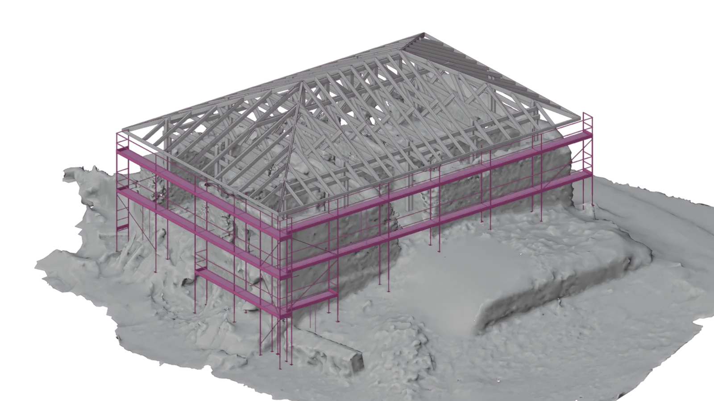
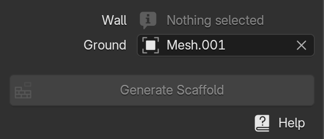
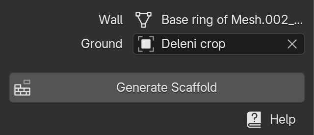

ScaffVisor is a Blender add-on that builds site scaffolding on the walls you mark, at the height of the faces you drew, and sits it on sloping ground. It gives you a bill of materials with weights while you work.

It is made for restoration and building-survey work: you have a photogrammetry scan or a rough volume of a building, and you need to see and count the scaffold before anybody orders it.

<figure class="hero"><figcaption>A test project: Plettac SL 70 on a photogrammetry scan of a ruin. Where the ground falls away, the scaffold gets extra lifts and compensation frames; the top deck stays level. 28.8 m of wall, 11 bays, 2 246 kg.</figcaption></figure>

ScaffVisor knows 23 scaffold systems: frame façade systems (Layher Blitz, Plettac SL, Altrad, Hünnebeck, Scafom-rux and others) and modular systems (ringlock, cuplock, kwikstage). Every dimension and weight comes from the manufacturer's published lists, and each system names its sources in the [systems catalog](catalog/).

## Install

You need Blender 4.2 or newer.

1. Download `scaffvisor-x.y.z.zip` from the [latest release](https://github.com/raduandrei-source/ScaffVisor/releases/latest).
2. Drag the zip into the Blender window, or open *Preferences › Get Extensions › ⌄ › Install from Disk*.
3. The panel appears in the 3D Viewport sidebar (**N**) on the **ScaffVisor** tab.

To update, disable the old version, drag in the new zip and enable it. No restart is needed.

## Your first scaffold in four steps

1. Select the building mesh (or planes you drew along the wall sides) and enter **Edit Mode**.
2. Select the wall faces you want scaffolded. The scaffold goes on the side the face normals point to.
3. Optional: pick the terrain mesh in **Ground**. Without it the ground is flat at the base of the faces.
4. Click **Generate Scaffold**.

<figure class="shot"><figcaption>Nothing selected yet: the panel says what it needs.</figcaption></figure>
<figure class="shot"><figcaption>A mesh is selected (its base ring becomes the path) and the scan is set as Ground.</figcaption></figure>

Then change anything in the panel. The scaffold updates as you go. Open **Result** to read the quantities and notes, and to export the bill of materials.

## Where to read next

- [Philosophy](philosophy.html): why the add-on works the way it does.
- [The panel](panel.html): every section and setting.
- [Systems and presets](presets.html): what is built in, how values are checked, how to add your own.
- [Systems catalog](catalog/): one sheet per system, with a model, dimensioned views, when to use it, its parts and sources.
- [All documented systems](systems.html): every system found in the documentation, grouped by grid.
- [Limits](limits.html): what it does not do, so you do not rely on it for the wrong thing.

**ScaffVisor gives an indicative layout and weights. It is not a stability calculation and does not replace the manufacturer's assembly manual or an engineer.**
