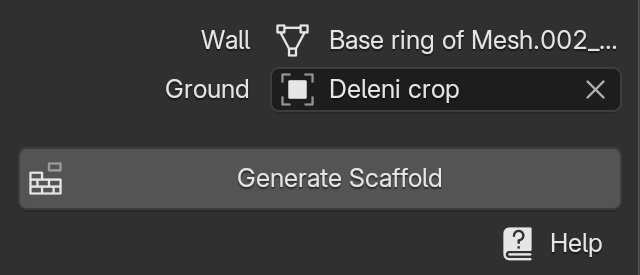
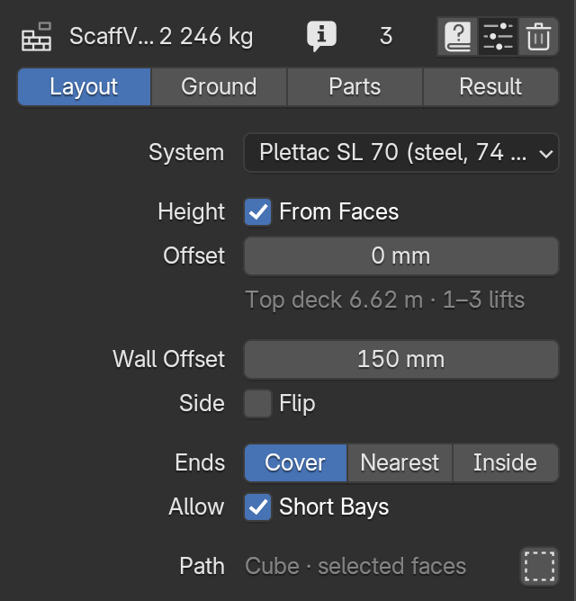
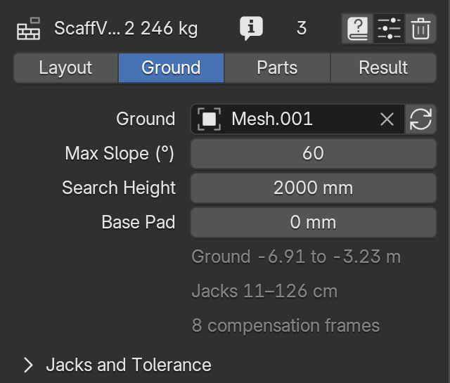
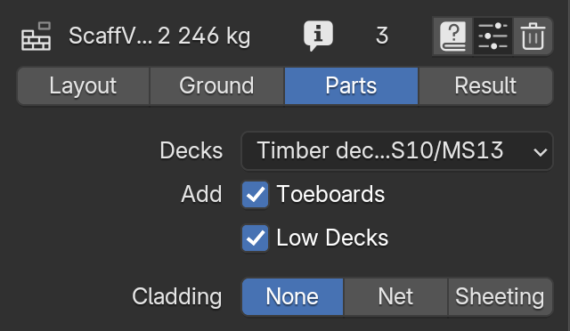
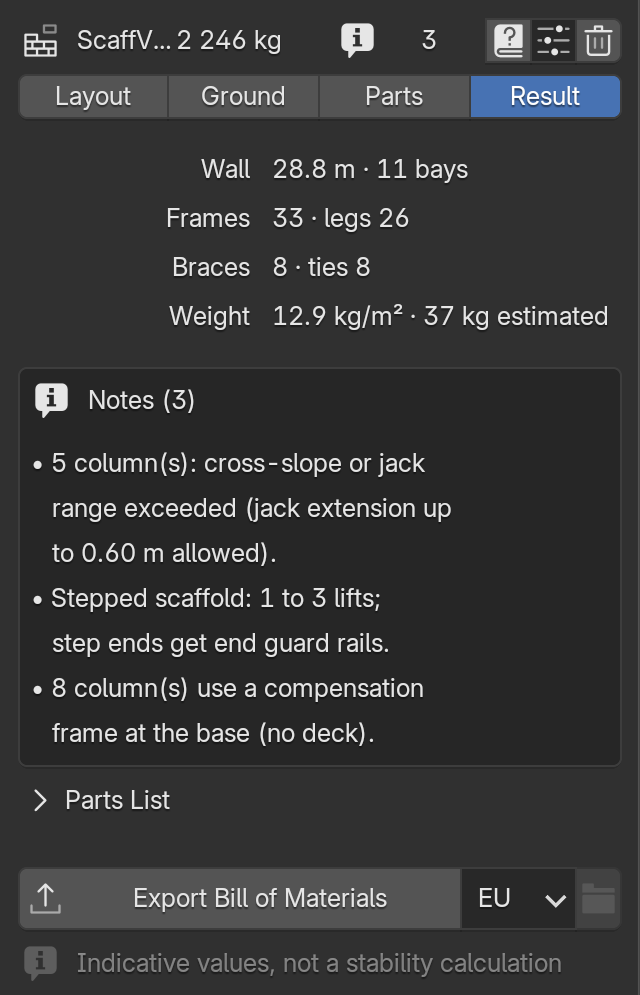

The panel lives in the 3D Viewport sidebar (**N**) on the **ScaffVisor** tab. The **?** button in the status strip opens the page of the section you are in.

## Before a scaffold exists

Three rows and one button.

<figure class="shot"><figcaption>Wall, Ground and Generate Scaffold.</figcaption></figure>

| Row | What it shows |
|---|---|
| **Wall** | What will be used as the path: selected faces or edges (Edit Mode), a curve, or the base ring of a mesh |
| **Ground** | Optional terrain mesh. It can be chosen while you are in Edit Mode, so you do not have to leave it |
| **Generate Scaffold** | Builds the scaffold. It is greyed out, with the reason on hover, when nothing usable is selected |

## The status strip

<figure class="shot"><figcaption>Status strip (name, weight, 3 notes, help, viewport options, delete) and the four sections.</figcaption></figure>

With a scaffold selected, the top line shows its name, its total weight, the number of notes (click it to read them), the help button, the viewport options and Delete. **Rebuild (Out of Date)** appears under it when Live Update is off or the scaffold is very large. A failed build is shown there as well, with the reason.

**Viewport options** change only what you see: guard rails, braces, ties, side arrows. Hidden parts stay in the bill of materials. **Live Update** rebuilds after every change; very large scaffolds wait for Rebuild.

## Layout

| Setting | Meaning |
|---|---|
| **System** | The scaffold system. The list is grouped by grid: systems with the same widths and bay lengths stand together. See the [systems catalog](catalog/) |
| **Height › From Faces** | Take each wall's height from its faces; **Offset** adds or subtracts a fixed amount (a negative value stops the top deck below the wall top) |
| **Height** | Used when the path is a curve or edges, or when From Faces is off |
| **Wall Offset** | Clear distance between the wall and the inner face of the frames. Above the system's limit (0.30 m for most systems) inner guard rails are added |
| **Side › Flip** | Put the scaffold on the other side of the wall |
| **Ends** | *Cover*: bays reach or pass the end of the wall. *Nearest*: total length as close as possible. *Inside*: never pass the end |
| **Allow › Short Bays** | Allow the short bays of the system for a closer fit |
| **Path** | Where the path came from. The button next to it replaces the path with the current selection |

The dimmed line under Height shows the resulting top deck height and the number of lifts.

## Ground

<figure class="shot"><figcaption>Ground range, jack range and the number of compensation frames, under the settings.</figcaption></figure>

Set **Ground** to the terrain mesh. A photogrammetry scan that also contains the ruin is fine.

| Setting | Meaning |
|---|---|
| **Max Slope** | Only terrain faces flatter than this angle count as ground, so ruin walls in the scan are ignored |
| **Search Height** | The ground is probed downwards from this height above the wall base. Keep it below overhangs and wall tops |
| **Base Pad** | Thickness of sole boards under the jacks |
| **Jacks and Tolerance › Jack Extension** | Preferred extension of the jacks when compensation frames are chosen |
| **Jacks and Tolerance › Top Deck Tolerance** | Let the top deck sit up to this much lower than asked, to need fewer compensation frames |

The refresh button next to Ground reads the terrain again after you edit it. Dimmed lines show the ground range, the jack range and the number of compensation frames.

If the scan has tall ruin tops next to the scaffold, use a cleaned copy of the terrain as Ground, or lower Search Height.

## Parts

<figure class="shot"><figcaption>Deck type, toeboards, low decks and cladding.</figcaption></figure>

| Setting | Meaning |
|---|---|
| **Decks** | Deck type of the system (timber grade, steel, aluminium …), which sets the weights |
| **Add › Toeboards** | Toeboards on open edges (15 cm, 11 cm in BOSTA). They complete the three-part edge protection |
| **Add › Low Decks** | A deck on top of each compensation frame where the ground is high |
| **Cladding** | None, net or sheeting. They multiply the number of ties (rule of thumb) |

## Result

<figure class="shot"><figcaption>Quantities, notes, the folded parts list and the export.</figcaption></figure>

Wall length and bays, frames (or standards for a modular system) and legs, braces and ties, weight per square metre, and how much of the weight is estimated. **Notes** lists what to look at: columns beyond the jack range, corners that are only approximate, parts without a deck. **Parts List** is folded away; a star marks estimated weights.

**Export Bill of Materials** writes a CSV to a folder named `<your file>_scaffvisor` next to the .blend, with the date and time in the name, so earlier exports are kept. The box next to the button chooses EU (semicolon, decimal comma) or US (comma, decimal point) numbers. The folder button opens the folder. A file that has not been saved yet exports to the temporary folder, and a warning says so. The notes are exported too.
